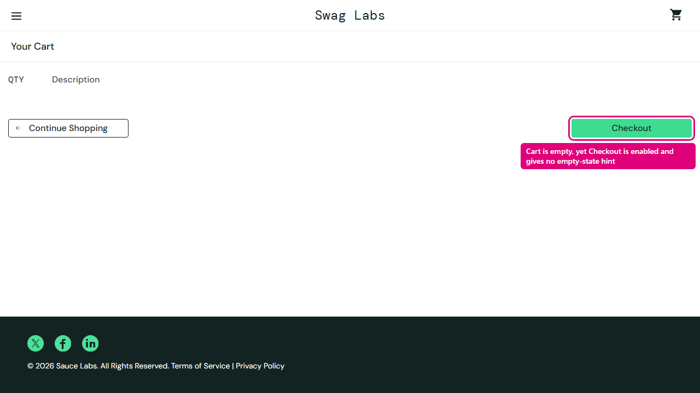
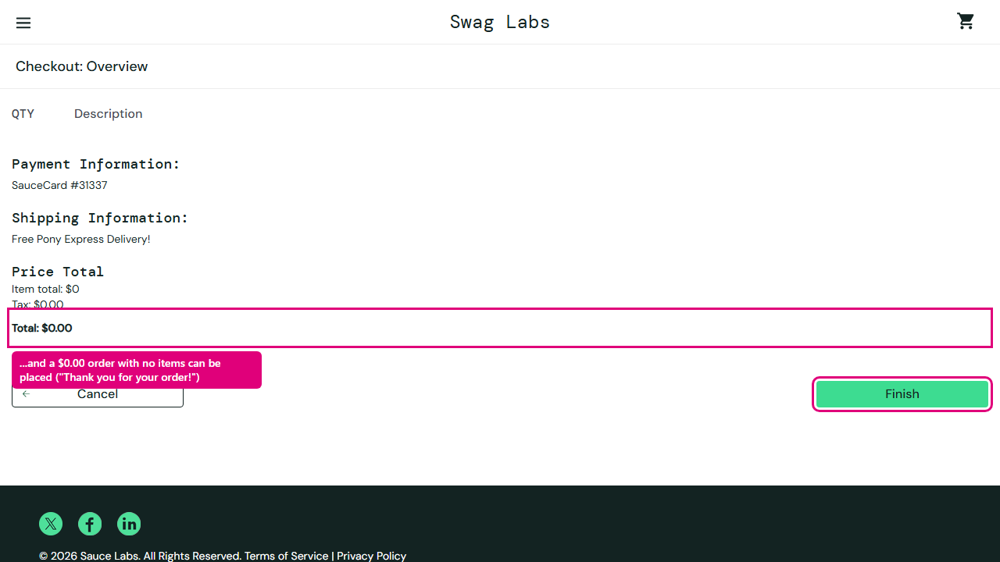
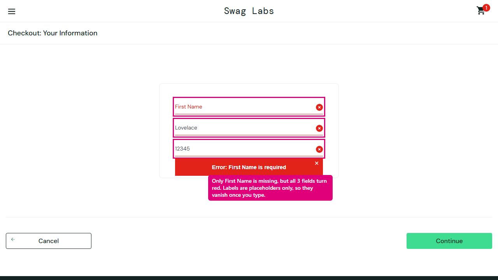
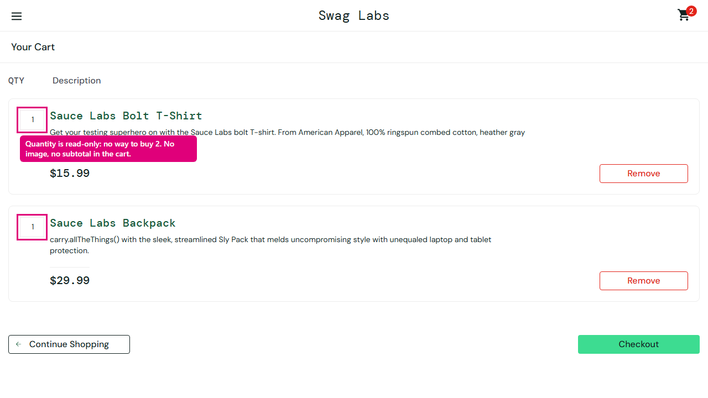
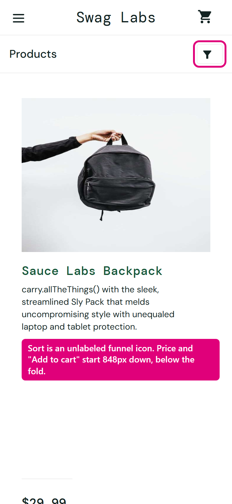
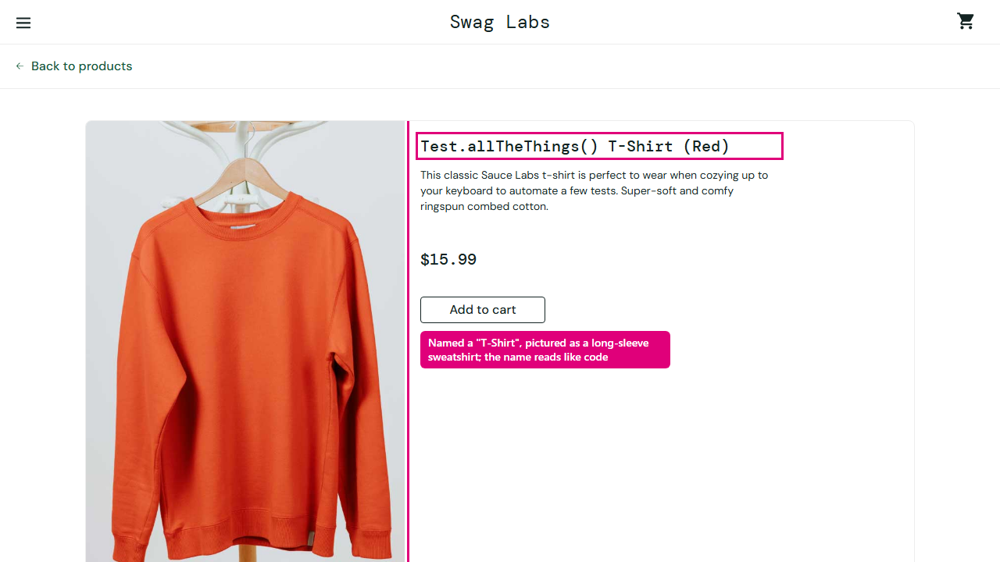

# UX review: Swag Labs from a real shopper's point of view

Reviewed as `standard_user` (the "working" shop) on desktop (1280×720) and mobile (375×812).
Screenshots come from [`scripts/ux-screenshots.ts`](../scripts/ux-screenshots.ts) (`npm run ux:screens`); magenta outlines mark the problem.
Ranked by how likely each issue is to cost a sale or a support ticket.

---

## 1. You can "buy" an empty cart, and the shop says thank you

| Empty cart, Checkout still active | $0.00 order goes through |
|---|---|
|  |  |

**Why it hurts:** the cart page has no empty state (just two column headers) and the primary green button still invites you to check out. You can fill the form and get "Thank you for your order!" for $0.00. A real shop would create junk orders and confused customers ("where's my order?").

**Improve:** show an empty-state block ("Your cart is empty" with a link to the products) and disable or hide **Checkout** while the cart is empty. Enforce the same rule on the server so `/checkout-step-one.html` can't be reached by URL.

---

## 2. The checkout form reports errors badly and asks for too little

**Why it hurts:**
- Only First Name is missing, but **all three fields turn red with ✕ icons**, so the shopper can't tell what's wrong. Errors also come one at a time: Continue, fix, Continue, fix.
- The labels are **placeholders only**. Once you type, nothing on the page says what the field was, which is an accessibility failure (WCAG 3.3.2).
- Whitespace-only names (`"   "`) pass (BUG-18). There's no shipping address and no payment choice; the overview just says "SauceCard #31337 / Pony Express".

**Improve:** add persistent labels above the inputs, validate inline on blur, mark only the invalid field, and put the message next to it (`aria-describedby`). Trim input before validating. Collect a real address, or say up front "we only need your name and ZIP".

---

## 3. The cart can't do cart things: no quantity, no image, no total

**Why it hurts:** **QTY** looks like an input but is read-only text, so buying two T-shirts is impossible. The cart has no thumbnails to confirm you picked the right item, and **no subtotal**, so the first time you see the price (plus tax) is two steps later on the Overview page. Adding to cart from the product list gives almost no feedback: the button changes to "Remove" and a small badge counts up.

**Improve:** add a quantity stepper (− 1 +), a thumbnail, and a running subtotal with an estimated-tax note in the cart. When something is added, show a short toast ("Added Backpack · View cart").

---

## 4. Mobile: one product per screen, and you can't see the price

**Why it hurts:** on a 375 px phone each product card is taller than the screen. The **price and Add to cart start 848 px down**, below the 812 px viewport, under a large blank gap. Sorting is a bare **funnel icon** (which usually means *filter*, not sort) and the current sort order isn't shown.

**Improve:** use a compact mobile card (image, name, price and button visible together, ideally a 2-column grid), remove the empty space, and label the control "Sort: Name A→Z".

---

## 5. Product names and pictures don't match, and read like code

**Why it hurts:** "Test.allTheThings() T-Shirt (Red)" is shown as an **orange long-sleeve sweatshirt**, and the description says "t-shirt" too. Shoppers return items that don't match the photo. The names and copy use developer jokes (`carry.allTheThings()`), and the shopper's menu exposes **"Reset App State"**, a debug tool that also leaves the page out of sync (BUG-19).

**Improve:** fix the product data so the title, photo, colour and category agree. Rewrite the copy for shoppers, and move "Reset App State" behind a dev flag. If it stays, rename it to "Clear cart" and re-render the page after it runs.

---

### Also noticed (smaller)
- Error and copy tone: "Epic sadface:" before every login error. The locked-out message gives no next step (contact support or reset).
- The screen-reader label on the cart reads "Cart, 1 items".
- There is no search, category filter, or product variant (size) on a clothing store.
- `performance_glitch_user` waits about 5 s on login and on every sort with **no loading indicator**, so it looks frozen.
